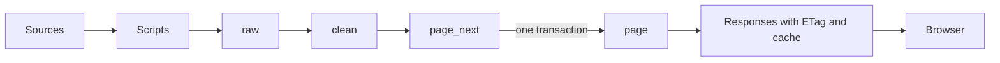

# Market data from the sources to the page

## Purpose

This document is the specification of the market data of Exchange Honey. It tells how the system gets the data from the sources, keeps the data and shows the data on a page. It also tells how to keep each page fast when the database has more than 1,000,000 rows.

## Terms

| Term | Content |
| --- | --- |
| Database | The PostgreSQL database of the Exchange Honey backend. The word "database" always means this database. |
| Database v5 | The file `Exchange_Honey_Global_Database_v5` (SQLite, 633 MB). It has 1,079,800 rows from many sources. It is not the database. |
| Seed | The rows that the system copies from database v5, for the AMS issues and the Census months that the system does not download. |
| Page layer | The small tables that a page reads. |
| Release | One version of the page layer. A NASS report and an AMS issue are not releases. |
| FAOSTAT | The data of FAO. `QCL` has the production. `PP` has the producer prices. `TCL` has the trade of each country. `TM` has the trade of each pair of countries. |
| NASS, ERS and AMS | Parts of USDA. NASS gives the colonies, the yield, the production, the stocks, the price and the value of honey for each US state. ERS gives series of the honey production and trade of the US. AMS gives the prices and the trade lines of the "National Honey Report". |

## Decision

- Use the source of each series as the primary copy of its data. Do not use database v5 as the primary copy.
- Use database v5 as a seed and as a test. In the tests of 2026-10-11, its FAOSTAT, NASS and ERS rows are the same as the sources.
- Keep the rows in the database. Do not keep the 633 MB file of database v5.
- Do not read a source, the `raw` layer or the `clean` layer when a visitor opens a page. A page reads only the page layer.

The last rule keeps the pages fast. A page does not read 1,000,000 rows. It reads small tables that the system makes before the visitor opens the page.

## Facts for the decision

- A page must not wait for a source. A source can be slow or can stop. Some sources give data only with a key.
- All downloads of previous AMS issues stopped with an error in the tests of 2026-10-11.
- `EH_TD_007` gives this rule: the marketplace must work when a data series stops.
- FAOSTAT and NASS change previous values. The database must keep the history of these values.
- Database v5 has no scripts and no PDFs of its sources. A person cannot make the data again from the file.
- The AMS rows of database v5 have defects. The section "Defects of the AMS rows of database v5" lists them.
- 38 percent of the rows of database v5 are not honey rows with a value, or are groups or duplicates.
- The zip file of the FAOSTAT table `TM` has 8.5 GB of data. A page cannot read it.

## Test results of database v5

The tests compared database v5 with the files of the sources and with the totals of FAOSTAT. The 6 parts in the table have 1,079,800 rows. This number is more than 1,000,000. The table gives the result for each part.

| Part of database v5 | Rows | Result of the test |
| --- | --- | --- |
| FAOSTAT | 449,540 | All rows are the same as the FAOSTAT files. |
| USDA: NASS, ERS and AMS | 42,812 | The NASS rows and the ERS rows are the same as the files of the sources. The AMS rows have defects. |
| US customs, tariffs and trade remedies | 37,608 | The rows agree with each other. The US import value is 5.3 percent below FAOSTAT. 30 of 31 rows of tariffs and remedies are the same as the sources. |
| IBGE (Brazil) | 365,175 | The difference from FAOSTAT Brazil is 0.1 percent or less in 49 of 51 years. |
| Eurostat and other customs data | 161,804 | In 117 of 140 tests, the difference between the World rows and FAOSTAT is 5 percent or less. |
| Other data of countries, and notes | 22,861 | Some tables give the same totals at 2 levels. |

673,620 of the 1,079,800 rows are honey rows that have a value and are not a group or a duplicate. 17,099 of these rows are prices.

## Defects of the AMS rows of database v5

- Database v5 has no AMS issue with a date in 4 months: 2020-04, 2025-04, 2026-04 and 2026-05.
- 4 issues have 9 quote rows or less: 2025-05-29 (1 row), 2026-03-31 (2 rows), 2026-06-30 (7 rows) and 2026-07-31 (1 row).
- The issue of 2026-09-30 has 62 quote rows. The PDF has 66 quote lines.
- 190 rows have the same content as a different row of the same issue. These are 63 quote rows, 99 export rows and 28 market notes.
- 47 of the 63 quote rows are in the issue of 2021-09-21. Database v5 has this issue two times, with 51 and 53 quote rows.
- 7,513 of the 8,819 import rows have no HTS line. This number is 85 percent.
- The column `month_cif_value_usd` has a different value in each format of the PDF. Rule 9 gives the rule for it.
- 12 import rows are `Grand Total` rows. They are not rows of an origin.
- 112 export rows have no month.
- 1 quote row, for Brazil in the issue of 2026-09-30, has the "floral source" "Mixed". Its line in the PDF starts with "Organic".

## Speed rules

| Number | Rule | Measure |
| --- | --- | --- |
| R1 | A page reads only the page layer. | The visitor role gets an error when it reads the `raw` layer or the `clean` layer. |
| R2 | A response has 5,000 rows or less. | The server stops a query that reads more rows. |
| R3 | The server sends the data in 100 ms or less when the cache has the data. It sends the data in 300 ms or less when the cache does not have it. | The 95th percentile of 200 requests on the full data. |
| R4 | The first view of the Index page gets 150 KB or less of data after `gzip`. | The sum of the bytes of the responses in the browser. |
| R5 | A new release goes live in one step. A page does not show rows of 2 releases. | The change is one transaction. |
| R6 | An update that stops with an error does not change the live release. | A test stops the script in the middle of an update. |
| R7 | A series that is not in the data shows "unavailable". The page does not show an estimate for the series. | A test removes a series. |
| R8 | A heavy export does not start in the request of a visitor. | No request of a visitor reads more than 5,000 rows. |

The product owner must agree to the numbers in R3 and R4 before the work starts.

## Layers

| Schema | Content | Who reads it |
| --- | --- | --- |
| `raw` | Each source row as the source gives it, with the previous versions. | The scripts and the tests |
| `clean` | The honey rows that have a value, with a mark for each group row and each duplicate. | The release build |
| `page` | Small tables for each part of the page. | The visitor role |
| `meta` | The tables `manifest` and `release`. | The scripts and the release build |

The data goes through the layers in this sequence:

The table `manifest` has one row for each download of a source file. The table `release` has one row for each release: number, time, status and result of the tests.

The `raw` layer keeps a null value as null and a zero value as zero. The `clean` layer drops the null values and marks the zero values.

## Tables of the page layer

Each table has an index for each filter of the page. The numbers of rows are a measure from a full update on 2026-10-12. The update used the FAOSTAT files of 2026-10-09 and the files that each other source had on that day.

| Table | One row for | Rows | Part of the page |
| --- | --- | --- | --- |
| `quote_index_month` | month | 90 | Quote index chart |
| `quote_month` | month, type, state or origin, "floral source", color class | 4,505 | Price panel |
| `regional_condition` | region, issue | 2,522 | Market notes |
| `production_country_year` | country, year | 7,570 | Production chart and table |
| `production_world_year` | year | 64 | Production chart for the World |
| `trade_country_year` | country, year, direction | 18,659 | Trade chart and table |
| `trade_world_year` | year, direction | 128 | Trade chart for the World |
| `trade_lane_year` | importer, exporter, year | 118,596 | Origin panel |
| `us_import_month` | origin, month, HTS line | 8,808 | US import panel |
| `us_supply_year` | state, year | 1,070 | US production panel |
| `us_series_year` | ERS series, year | 5,768 | US series panel |
| `us_port_month` | flow, HS6, month, country, port | 37,478 | US port panel |
| `tariff_line` | tariff line | 15 | Tariff panel |
| `remedy_rate` | country, exporter | 0 | Trade remedy panel |
| `source_note` | source or file | 489 | Source note |
| `release_info` | release | 1 | `ETag` of each response |

The page layer has about 206,000 rows and 27 MB. The system makes it again for each release. The table `remedy_rate` has no row until a person gives approval to a rate. Each part of the live Index page shows about 100 values or less. Thus each query reads a small part of one table.

## Methods for the speed of a page

- Make an index for each filter of a table of the page layer.
- Set a time limit of 2000 ms for each query of the visitor role.
- Send the header `ETag` with the release number. Send `Cache-Control: public, max-age=300, stale-while-revalidate=86400`.
- Send a 304 response, without a query, when the `ETag` of the request is the same.
- Get only the parts at the top of the page in the first view. Get each other part when it comes into view.
- Send small JSON with `gzip` or `brotli`.
- Give a table of more than 500 rows in pages of 500 rows or less.
- Sort and filter a table of more than 5,000 rows in the server.

## Release build

The command `marketdata update` does these steps. The command `marketdata rollback` does the last one.

1. Get the date of the file of each source from the source. Stop here for a file that has the date of the last download.
2. Download each file that has a new date. Stop here for a file that has the hash of the last download. Write the rows of each other file to the `raw` layer. Add a row to `manifest`.
3. Start a build when no release is live. Start it also when a source has a download that the live release does not use.
4. Get the build lock. Add a row to `release` with the status "building".
5. In one transaction, make the `clean` rows again. Make the tables of the page layer in the schema `page_next`.
6. In the same transaction, do the release tests. When a test gives an error, end the transaction with no commit and set the status "failed". The live release does not change.
7. In the same transaction, remove `page_prev`. Change the name of `page` to `page_prev` and the name of `page_next` to `page`. Set the status "live".

Keep `page_prev` until the next release. To go back, change the names of `page` and `page_prev` in one transaction.

## Read the page layer

A request that reads two tables of the `page` schema must read `release_info` first. This rule holds also for a request that reads one table and the release number for the `ETag`. Read `release_info` in the same transaction, or at the start of the same statement.

The change of a release locks `release_info`. The lock waits for each request that holds a lock on the table. A new request waits until the change ends. Thus a request that obeys the rule reads one release in all its statements.

A request that does not obey the rule can read tables of two releases. The server finds the name `page` again for each statement. A change between two statements of the request changes the tables that the name gives.

## Role of the visitor

The role `eh_visitor` cannot sign in. The server signs in with a different role. For each read, the server starts a read-only transaction and changes to `eh_visitor`. The role can read the tables of `page` and `page_prev`. The role cannot read or change a table of the other schemas.

The release build gives the role the right to read each new `page_next` schema. A schema keeps its rights when it gets a new name. Each statement of a read has a time limit of 2000 ms. A test makes sure that the role has no other right.

## API of the page layer

The API gives the page layer to a visitor. All routes use the method GET. The path of each route starts with `/api/v1/market`. A client can send 300 requests in 1 minute from one address.

| Route | Query | Response |
| --- | --- | --- |
| `release` | none | The number of the live release and its time. |
| `production/countries` | `year`, `limit`, `offset` | The countries sorted by their production in one year. |
| `production/countries/{areaCode}` | none | The production of one country for each year. |
| `production/world` | none | The production of the World for each year, with its flag. |
| `trade/countries` | `year`, `direction`, `sort`, `limit`, `offset` | The countries sorted by their import or export in one year. |
| `trade/countries/{areaCode}` | none | The trade of one country for each year and direction. |
| `trade/world` | none | The trade of the World for each year and direction, with the flags. |
| `trade/lanes` | `reporter`, `partner`, `year`, `direction`, `sort`, `limit`, `offset` | The pairs of countries. A request must name a reporter or a partner. |
| `overview` | none | 6 numbers for the top of the page. Each number has the flag `unavailable`. |
| `sources` | none | The last download of each source, in groups. |
| `us/supply` | `geography`, `from`, `to` | The US supply for each year: colonies, yield, production, stocks, price and value. |
| `us/supply/states` | `year`, `sort`, `limit`, `offset` | The states sorted by production, yield, price or colonies in one year. |
| `us/series` | `attribute`, `table`, `from`, `to` | One ERS series for each year. A request must name an attribute. |
| `us/series/attributes` | none | The list of the ERS series. |
| `us/ports` | `flow`, `hs6`, `month`, `limit`, `offset` | The US ports sorted by value in one month. |
| `us/ports/partners` | `flow`, `hs6`, `month`, `limit`, `offset` | The partner countries of the US sorted by value in one month. |
| `us/ports/series` | `flow`, `hs6`, `from`, `to` | The value and the quantity for each month. |
| `tariff` | `system`, `code`, `limit`, `offset` | The tariff lines of honey and beeswax. |
| `remedies` | none | The rates of the trade remedies that a person approved. The list is empty until a person gives approval to a rate. |
| `prices/quotes` | `from`, `to`, `market`, `certification`, `region`, `variety` | The AMS quotes for each month. |
| `prices/filters` | none | The values that `prices/quotes` accepts. |
| `prices/index` | `from`, `to` | The quote index for each month. |
| `prices/us/imports` | `month`, `origin`, `hts_line`, `sort`, `limit`, `offset` | The import lines of the AMS report for one month. |
| `prices/us/imports/months` | none | The months that have import lines. |
| `prices/conditions` | `region`, `from`, `to`, `limit`, `offset` | The market notes of the AMS report for each region. |

Each response has the key `release` with the number and the time of the release of its data. When a request has no `year`, the response uses the last year in which 50 countries or more have a row. A response has 500 rows or less. A request with no `limit` gets 20 rows of countries and 50 rows of pairs of countries.

The `ETag` of a response is `W/"r<number>"`, with the number of the release. When the header `If-None-Match` has the tag of the live release, the server sends the status 304 and does not read the database. The server keeps the number of the live release in memory and reads it again each 10 seconds. The server sends `Cache-Control: public, max-age=300, stale-while-revalidate=86400` and `Vary: Accept-Encoding`. It sends the response with `gzip` when the client sends `Accept-Encoding: gzip`.

A bad parameter gives the status 422 with the name of each bad parameter. An area code that is not 1 to 5 digits gives the status 404. The status 503 with the code `market_unavailable` means that no release is live. The status 503 with the code `market_timeout` means that a read was longer than 2000 ms. An error response has no `ETag`. It has no header that lets a cache keep it.

## Sources and scripts

Write the scripts in Go in the directory `backend/` of the Exchange Honey repository. `EH_TD_008` gives this rule. A test tool can use other software for the one-time tests, but it is not part of the application.

| Source | Method | Test for a change | Step |
| --- | --- | --- | --- |
| FAOSTAT `QCL`, `PP`, `TCL` and `TM` | Read the zip files. Keep the items 1181 (bees), 1182 (natural honey) and 1183 (beeswax), the hash of the archive and the row number. | `Last-Modified`, then the hash | 1 |
| ERS (USDA) honey CSV | Download the file `us-honey-production-and-trade.csv`. The server sends no `Last-Modified`. The file has 5,768 values. | Hash | 1 |
| NASS (USDA) `Honey` | Download the ZIP file of each report from the list of the publication `Honey`. The list has 6 pages and 25 ZIP files. Do the same for the publication `Honey - Final Estimates`. It has 1 ZIP file with new values for 2013 to 2017. Read the CSV in the ZIP. | New ZIP | 1 |
| Census port trade HS6 | Read the files `PORTHS6MM` and `PORTHS6XM` of the last 24 months. A key is not necessary. Seed the first months from database v5. | `Last-Modified`, then the hash | 1 |
| USITC HTS and Census Schedule B | Read the CSV of the newest HTS revision and the file of Schedule B. Keep the lines for honey and beeswax. The HTS file has 35,806 lines and 11 of them are for honey and beeswax. | `Last-Modified`, then the hash | 1 |
| Trade remedies | Keep a table that a person agrees to. Read the notices of the Federal Register for each case to tell the person about a new notice. The case A-570-863 has 202 notices on 3 pages. | New list of notices | 1 |
| AMS (USDA) "National Honey Report" | Download the PDF of the last issue. Read it with a parser in Go. Seed the issues before it from database v5. | Hash | 2 |
| Census HS10 API | A key is necessary. The key is not in this repository. The API gives the HTS line, the freight and the duty. The system does not read this source. | New month | 2 |
| Eurostat, IBGE and others | Read the country totals. The system does not read these sources. | New data | 3 |

Step 1 has the sources that are the same as database v5 in the tests. Step 2 has AMS, which has defects in database v5, and the Census HS10 API, for which a key is necessary. Step 3 has the sources that the first pages do not use.

## Rules for the scripts

1. Start a download only when the test for a change shows a new file. The date of the file is the first test.
2. Write one row to `manifest` for each download: address, time, `Last-Modified`, hash and number of rows.
3. Give each row a natural key. A new read of the same file adds no rows.
4. Keep the previous row when a source changes a value. Close the previous row. Add a new row for the new value.
5. Mark each group row, for example the FAOSTAT groups, the Eurostat groups and the World rows. The release build does not add a group row to the country rows.
6. Mark each mirror row. A mirror row is a trade flow that the importer and the exporter each report. The release build does not add the 2 sides.
7. Keep one row for the same content in an AMS issue. When database v5 has an issue two times, keep the first copy.
8. Give each AMS import row its HTS line from the heading. A row without a line gets the mark `unknown_grade`.
9. Keep 3 values for an AMS import row: the customs value, the freight and insurance, and the CIF value. In database v5, the column `month_cif_value_usd` has the CIF value in the rows of the first format of the PDF. In the rows of the other format, it has the freight and insurance. Use the format of the PDF to find which value the column has.
10. Stop with an error when a file has a new format. The live release does not change.
11. Use the hash of the file after the download. A new date on the same bytes is not a new file. It adds no manifest and no release.
12. Write one list for the notices of each Federal Register case. A list that is the same as the last list adds no manifest.
13. Send a request to USITC with the name `Go-http-client/1.1`. The USITC server sends the status 403 to a name that it does not know.

## Classes of data

Each `clean` row has one class: `quote`, `customs_unit_value`, `producer_price`, `production`, `trade_flow` or `rate`. A table of the page layer has one class. A chart does not show 2 classes as one series. `EH_TD_007` gives the same rule.

## Seed from database v5

The command `marketdata seed --v5 <file>` copies the AMS issues and the Census months of database v5 into the `raw` layer. It reads the file with the program `sqlite3`. The server does not use this program. The seed makes no release. Start `marketdata update` after the seed.

Mark each seed row with the version `v5_2026_10_01`. The seed does not copy the 12 `Grand Total` import rows and the 112 export rows with no month. It corrects the "floral source" of the Brazil quote row. It puts the freight and insurance of the first format in the column for them. The seed does not remove the rows that have the same content as a different row. The page layer shows a month of quotes only when the month has 10 "domestic" quotes or more.

The seed has no IBGE rows and no Eurostat rows, because the system does not read these sources. Set `EH_PDF_DIR` to keep the AMS PDF files. Without it, the system does not keep the PDF of the last issue.

## Tests

| Number | Test | Correct result |
| --- | --- | --- |
| T1 | Read the FAOSTAT files. Compare the rows with database v5. | 0 differences in value and flag for `QCL`, `TCL` and `TM`. |
| T2 | Read the NASS ZIP files of 6 reports. Compare the rows with database v5. | 254 of 254 rows of production and 442 of 442 rows of revisions are the same. |
| T3 | Read the ERS file. | 5,768 of 5,768 values are the same. |
| T4 | Read the Census files. Compare the totals with database v5. | The total value is different by less than 1 percent for the months that are in the files and in database v5. |
| T5 | Read the AMS issue of 2026-09-30. | The parser finds 66 of 66 quote lines. Database v5 has 62. |
| T6 | A person counts the quote lines of 3 AMS issues from 2026-02 to 2026-06. | The counts are the same as the output of the parser. |
| T7 | Send each query of the visitor role 200 times on the full data. | The 95th percentile is in the limits of R3. |
| T8 | Connect with the visitor role. Read the `raw` layer. | The database gives an error. |
| T9 | Read the same file 2 times. | The number of rows does not change. |
| T10 | Stop a release build in the middle. | The live release does not change. |
| T11 | Change to the previous release and back. | The pages show the same numbers as before. |

Keep a sample file of 1,000 rows or less for each source in the tests of the repository. Use the full file of database v5 only for the one-time tests T1 to T5.

## Results of the full update

The full update of 2026-10-12 started with an empty database. It read the files that each source had on that day. The time of the command `marketdata seed` is 9 seconds. The time of the first `marketdata update` is 873 seconds, and most of this time is for the 48 files of Census (721 MB). The time of the release build is 1.2 seconds. The 24 release tests give the correct result.

| Number | Result |
| --- | --- |
| T1 | Done before this update: the 449,540 rows of FAOSTAT are the same as database v5. |
| T2 | The system reads 26 NASS reports. 1,070 of 1,070 rows are the same as database v5 for the last report of each state and year. |
| T3 | ERS has 5,768 values. The number of values and the sum of the values are the same as in database v5. This update did not compare each value. |
| T4 | 796 of 796 groups of month, flow and HS6 code have the same value as database v5. In 4 groups, database v5 has more rows, and these rows have the value zero. |
| T5 | The parser finds 66 of 66 quote lines in the issue of 2026-09-30. Database v5 has 62. 103 of 104 issues have the same number of quotes as database v5. |
| T6 | Not done. A person must count the quote lines. |
| T7 | The 95th percentile of each of the 25 routes is 8.1 ms or less with 1 client and with 8 clients. R3 gives the limit of 100 ms. For the status 304, the 95th percentile of each of 6 routes is 0.11 ms or less. |
| T8, T10, T11 | The tests of the repository give the correct result. |
| T9 | The second update has no new manifest and no new release. It reads no row again. |

The time of the second update is 196 seconds. In 3 tests, 5, 7 and 12 of the 48 Census files have a new date for the same bytes. The system downloads each of these files and finds the same hash.

The two responses with the most data after `gzip` are `prices/conditions` with 15 KB and `sources` with 12 KB. R4 gives a limit for the first view of a page. The page does not use the API at this time, thus the system has no test of R4.

## Risks

| Risk | Do this |
| --- | --- |
| The AMS archive site `mymarketnews.ams.usda.gov` does not send data. All downloads of previous issues stopped with an error in the tests of 2026-10-11. | Store each PDF at the first download. Try again at the next update. Keep the live release. |
| A source of the US stops a series. The AMS issue of 2026-09-30 gives the cause "a lapse in federal funding" for its stopped export table. | Show "unavailable" and the date of the last data. |
| A source changes its format. | The script stops with an error. The live release does not change. |
| A key is necessary for the Census HS10 API and NASS `Quick Stats`. | Keep each key in the server. Do not put a key in the repository. |
| Some tariff sources do not let the site show their numbers. | Copy `blocked_source_catalog` and `global_tariff_rights_audit` from database v5. The page layer uses only the sources that the product owner agrees to. |
| A full FAOSTAT update downloads about 740 MB. | The test for a change stops the download when the files are the same. |
| On some requests, the CDN of Census sends a new `Last-Modified` for the same bytes. 5 to 12 of 48 files have this in a test. | Use the hash after the download. An update with no change downloads 77 MB to 157 MB, adds no manifest and adds no release. |
| The Federal Register API gives 100 documents on each page, and the case A-570-863 has 3 pages. | Read all the pages. Stop with an error when a case has more than 10 pages. |
| NASS gives new values for 2013 to 2017 in a second publication. Database v5 has them. | Read the publication `Honey - Final Estimates` too. For each year, the last report that has the year gives the values. |

## Limits

- The purpose is not to keep the 1,079,800 rows of database v5. The purpose is to keep the rows that the pages use.
- This specification does not include the deal data of the marketplace.
- This specification does not include a forecast.
- This specification does not change the tool of this repository.

## Open decisions

- The product owner must agree to the numbers in R3 and R4.
- The product owner must select the series for the visitor role and the sources that the site can show.
- A person must agree to each rate of a trade remedy. The table `remedy_rate` is empty until a person does this.
- Select if the site shows the data of Brazil for each municipality. Database v5 has 143,708 values for municipality and year, and no price.
- Select the directory for `EH_PDF_DIR` in production.
- Select when the system reads the Census HS10 API, IBGE and Eurostat. At this time the system does not read these sources.

## References

- `DATA_SOURCES.md` is the specification of the FAOSTAT data in this repository.
- `DATA_UPDATE.md` is the specification of the test for a change and of the update each week. The FAOSTAT script uses the same method.
- `EH_TD_007` is the specification of the market data of Exchange Honey. `EH_TD_008` is the specification of the backend and its tools.
