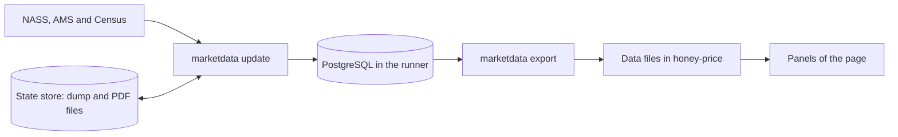

# United States panels on the honey price page

## Purpose

This document is the specification of the United States panels on the honey price page. It gives the content of the panels. It also tells how the data come to the page and how the system updates them each week.

The document `2026_10_11_MARKET_DATA_DESIGN.md` tells how the scripts of Exchange Honey get and keep the data. This document uses its terms.

## Status of this document

The version of 2026-10-12 of the page has the panel "Production and price" of NASS only. The panels of AMS and Census are not in this version. The data of the panel come from the script `scripts/build_us_data.py`, which reads the reports of NASS. The scripts of Exchange Honey are not in use. The 3 sections about the scripts of Exchange Honey and the workflow of each week give the plan for the 3 panels. The files `DATA_SOURCES.md`, `DATA_UPDATE.md` and `PAGE_BEHAVIOR.md` give the specification of this version.

## Decision

- Add a section "United States" to the page. It has 3 panels. The sources are NASS, AMS and Census.
- Get the data with the scripts of Exchange Honey. Do not write a second reader for each source.
- Put the data in 3 data files. The page gets a file when its panel comes into view.
- Update the data files each week with a workflow of GitHub. The page does not use a server.
- Keep the rows of the database in a dump, because a workflow has no database between 2 starts. Keep the dump in the state store.
- Keep FAOSTAT in `scripts/build_data.py`. This version changes that script only for the revisions of the USDA.

## Terms

| Term | Content |
| --- | --- |
| Panel | A part of the page with a title, charts, a table and a line for the source. |
| Class | The type of a value. The classes here are `producer_price`, `quote` and `customs_unit_value`. |
| Report | A NASS publication of one date. It has the values of one year or more. |
| Issue | An AMS "National Honey Report" of one date. |
| Release | A version of the page layer in the database. The market data specification gives its rules. |
| State store | The files that the workflow keeps between 2 starts. It is a GitHub release with the tag `state`. |
| Dump | A file that has all the rows of the database. |
| Data file | A file in the directory `data` that sets one value on the page. |

## The section "United States"

The section "United States" is below the table of countries. It has 3 panels and one year control. A panel gets its data file when it comes into view.

| Panel | Source | Class | First data | Last data |
| --- | --- | --- | --- | --- |
| Production and price | NASS `Honey` | `producer_price` | 2000 | The last report |
| Quotes | AMS "National Honey Report" | `quote` | 2017 | The last issue |
| Trade | Census, port data | `customs_unit_value` | 2010 | The last month |

### Year control

The section has a list of years. It is not the slider of the page, because the slider stops at the last year of FAOSTAT. The US sources have newer years.

The list has the years from 2000 to the last year of the 3 sources. It starts with the last year in which all 3 sources have data. The 3 panels use this year. The address key `uy` keeps it.

### Production and price (NASS)

- Two charts show the United States for each year: the production and the price. The selected year has a mark.
- Each year has 2 points: the first estimate and the last value. The message of a chart gives the date of each report.
- The table shows the states for the selected year. The columns are colonies, yield, production, stocks, price and value.
- A click on a heading sorts the table, as in the table of countries.

### Quotes (AMS)

- The chart shows the quote index for each month. The index is 100 for the median of the medians of the months of 2024. It uses the "domestic" quotes only.
- A month with 9 "domestic" quotes or less has no point. A gap stays a gap.
- The table shows the quotes of one month: market, region or origin, variety, color, low, high, average and number of quotes.
- A list shows the months of the selected year that have quotes. The page selects the last of them. The address key `m` keeps the month.
- A quote is not the price of a deal. The text of the panel gives this information.

### Trade (Census)

- A switch selects Imports or Exports. The goods are natural honey (HS6 code `040900`). The address key `f` keeps the selection.
- Two charts show the value and the customs unit value for each month. The months of the selected year have a mark.
- Two tables show the top 15 partner countries and the top 15 ports for the selected year. They give the value, the quantity, the share and the customs unit value.
- For the last year, the tables show only the months that have data, for example "January to August 2026".
- A customs unit value is the customs value divided by the weight. It is not a price. A partner or a port with less than 100 tonnes in the year has no unit value, because a small quantity gives much noise.

### Rules for all panels

1. A chart has values of one class. The page does not show 2 classes in one chart.
2. A year or a month that is not in the data is a gap. The page gives no estimate for it.
3. A panel with no data for the selected year shows the text "No data for this year". It gives the first and the last year of its source.
4. Each panel shows its source, its class and the date of its last data. The section shows the status date.
5. The unit control of the page changes the unit of the 3 panels. Production and quantity use pounds, kilograms or tonnes. Prices, quotes and unit values use US dollars for each pound, kilogram or tonne.
6. When a data file does not come, the panel shows a message with the name of the file. The other parts of the page work.
7. A key of the address with an incorrect value does not change the selection.

## How the data come to the page

The workflow gets the data from the 3 sources with the scripts of Exchange Honey. The scripts keep the history in a database. The export command makes the data files from the live release. The page reads only the data files.

The page gets a data file with a script element that `us.js` adds to the page. Thus the page works when a person opens `index.html` in a browser, with no server.

## Data files

All data files have the same format. The first line is a note. The next part sets one value on `window`, for example `window.HONEY_US_SUPPLY = {...};`. The JSON has sorted keys and no spaces. The same data give the same bytes. A value that the source does not have is null.

| File | Value on `window` | The page gets it |
| --- | --- | --- |
| `data/us_status.js` | `HONEY_US_STATUS` | With the page |
| `data/us_supply.js` | `HONEY_US_SUPPLY` | When the panel comes into view |
| `data/us_quotes.js` | `HONEY_US_QUOTES` | When the panel comes into view |
| `data/us_trade.js` | `HONEY_US_TRADE` | When the panel comes into view |

The file `us_status.js` has one key: `{"checked": "YYYY-MM-DD"}`. The workflow writes it. It has the status date.

Each of the 3 other files has the key `meta`.

| Key | Content |
| --- | --- |
| `source` | The name of the source |
| `url` | The address of the source |
| `retrieved` | The date of the update, in UTC |
| `last` | The date of the last report or issue, or the last month `YYYY-MM` |

Each of the 3 files must have less than 100 KB after `gzip`. A test gives an error when a file is larger.

### The file `us_supply.js`

The file `DATA_SOURCES.md` gives the fields of this file in its section "United States data". The key `reports` has the date, the publication and the link of each report. The key `rows` has the values of the newest report for each area and year. The key `us` has the first estimate and the second estimate of each year. The key `evidence` has the revisions of the USDA.

### The file `us_quotes.js`

| Key | Content |
| --- | --- |
| `months` | The months that have a point of the index. A month is `YYYY-MM`. |
| `index` | One row for each month: `[month, index, median, quotes]`. The median is in US dollars for each pound. |
| `names` | The lists of text for `rows`: `markets`, `certifications`, `regions`, `varieties` and `colors` |
| `rows` | One row for each month, market, certification, region, variety and color |

A row of `rows` is an array: `[month, market, certification, region, variety, color, average, low, high, quotes]`. The first 6 fields are indexes. The prices are in US dollars for each pound.

### The file `us_trade.js`

| Key | Content |
| --- | --- |
| `months` | All months from the first to the last, `YYYY-MM` |
| `flows` | The list `["import", "export"]` |
| `totals` | One row for each flow and month: `[flow, month, value, weight]` |
| `years` | The years, from 2010 to the last year |
| `names` | The keys `partners` and `ports`. Each entry has the code and the name. |
| `partners` | One row for each flow, year and partner: `[flow, year, partner, value, weight]` |
| `ports` | The same as `partners`, for the ports |

The value is in US dollars. The weight is in kilograms. It is the air weight plus the vessel weight. The rows of `partners` and `ports` have the top 15 entries of the flow and the year, by value. The index -1 is the total of all other entries.

## Workflow of each week

The workflow `.github/workflows/update-us-data.yml` starts each Monday at 06:17 UTC. A person can also start it. It has the permissions `contents: write` and `pages: write`, as the workflow "Update data" has. Only one start of the workflow works at one time.

The workflow has these steps:

1. Get the repository.
2. Get the repository `exchange-honey-web` at the commit in the variable `EH_SCRIPTS_REF`. Use the read-only key in the secret `EH_SCRIPTS_KEY`.
3. Install Go and `pdftotext`. Build the command `marketdata`.
4. Start a PostgreSQL 18 database in the runner. Read the dump `us-state.dump` of the state store into it.
5. Start `marketdata update --only nass,ams,census`. Set `EH_PDF_DIR` to make sure that the command keeps each new AMS PDF file.
6. Start `marketdata export --out data`.
7. Write `data/us_status.js` with the status date.
8. When a file in `data` is different, save the change in the repository and send it to the branch. Then send a request for a Pages build.
9. Make a new dump. Put it and the new PDF files in the state store. Do this only when the steps 1 to 8 have no failure.

Step 8 uses the method of the workflow "Update data". The message is "Update US honey data" when a data file is different. It is "Record the US data status" when only `us_status.js` is different.

### State store

The state store is the GitHub release with the tag `state`. It has the file `us-state.dump` and one file for each AMS issue. The name of an AMS file is `<hash>.pdf`, with the hash of the file. The database has the date of the issue for each hash. Each good start replaces the dump. A release has no limit for the total of its files, and each file must be less than 2 GB.

The files of the state store have only data of USDA and Census. A repository that is open to all has no charge for the standard runners of GitHub.

### Secrets and variables

| Name | Type | Content |
| --- | --- | --- |
| `EH_SCRIPTS_KEY` | Secret | The key for the repository `exchange-honey-web`. It gives read access only. |
| `EH_SCRIPTS_REF` | Variable | A commit of `exchange-honey-web`. The workflow builds the scripts of this commit. |

The workflow uses no other secret. The command `marketdata` does not write a key or a database address in its output.

### First dump

The first dump comes from a person who has the file of database v5. The person does these steps one time on a computer. Start a PostgreSQL database. Start `marketdata seed --v5 FILE --only ams,census`. Start `marketdata update --only nass,ams,census`. Make the dump and put it in the state store.

### Failure

A failure in a step stops the workflow. The workflow saves no change and does not change the state store. GitHub sends a message about the failure. The page keeps its last data.

Each panel shows the date of its last data. The section shows the status date. A status date that is more than 1 week before the day on which you look at the page shows a problem.

## Changes in the scripts of Exchange Honey

The scripts of Exchange Honey are in the repository `exchange-honey-web`, in the directory `backend`. This version makes these changes:

- The command `marketdata update` has the option `--only NAMES`. It reads only the sources with these names and builds the release from their tables.
- The new command `marketdata export --out DIR` makes the 3 data files. It reads the live release in a read-only transaction with the role `eh_visitor`. It writes each file to a temporary file and then changes its name.
- When no release is live, `marketdata export` writes no file and ends with the exit code 1.
- The source NASS makes a new table of the page layer: `us_supply_revision`. It has one row for each area and year, with the first, the second and the last report and their values.
- The export command reads only tables of the page layer.

## Changes in this repository

| File | Change |
| --- | --- |
| `index.html` | The section "United States", the script elements for `ui.js` and `us.js`, and the file `us_status.js` |
| `ui.js` | New. It has the functions that `app.js` and `us.js` use: the elements of the page, the units and the formats of numbers. |
| `app.js` | It uses `ui.js`. It works as before. |
| `us.js` | New. It has the panels, the year control and the get of the data files. |
| `styles.css` | The style of the section |
| `scripts/build_us_data.py` | New. It reads the reports of NASS and makes `data/us_supply.js` and `data/us_status.js`. |
| `scripts/build_data.py` | It reads the revisions of the USDA from `data/us_supply.js`. |
| `scripts/test_us_data.py` | New. It examines the script and the data files. |
| `.github/workflows/update-us-data.yml` | New. It starts `scripts/build_us_data.py` each week. |
| `DOCS/SPECS` | `PAGE_BEHAVIOR.md`, `DATA_SOURCES.md` and `DATA_UPDATE.md` get a section for the US data. |

## Revisions of the USDA

The file `scripts/uncertainty.py` has `EVIDENCE['usda']`. It has the years and the largest revisions of the USDA for US honey. A person typed these numbers.

This version calculates them. Use the years from 2017 to the last year that has a second report. The second report is the next report that has the year. For each year, find the ratio of the second value to the first value. Find the natural logarithm of the ratio, without its sign. The result is the largest of these numbers, for the production and for the price.

The test of 2026-10-12 used the 9 reports from 2018-03-14 to 2026-03-13. The result is 0.0108 for the production (year 2018) and 0.1099 for the price (year 2024). The typed numbers are 0.011 and 0.11. They agree.

The script `scripts/build_us_data.py` writes the result in the key `evidence`. The script `scripts/build_data.py` reads `data/us_supply.js` when it is there. It changes the 2 numbers to 3 decimals and keeps them in `meta.uncertainty.rubric.evidence.usda`. When the file is not there, or its format is not correct, the script uses the typed numbers.

## Tests

| Number | Test | Correct result |
| --- | --- | --- |
| U1 | Make the 3 files from a database that has the fixtures of the sources. | Each file has the values of the fixtures. |
| U2 | Make the files two times. | The bytes are the same. |
| U3 | Start `marketdata export` when no release is live. | The exit code is 1 and no file is there. |
| U4 | Start `marketdata update --only nass,ams,census`. | Only these 3 sources have a new row in `manifest`. |
| U5 | Read the table `us_supply_revision` for the year 2024. | The first report is 2025-03-14 with 2.69 US dollars. The last is 2026-03-13 with 2.41. |
| U6 | Examine the data files in `data`. | Each file has the keys, the types and the limits of this document. |
| U7 | Calculate the revisions from the rows `us` in a test. | The result is the same as the key `evidence`. |
| U8 | Open the page in a browser, with no server. | The first view gets `us_status.js` and no other `us_*.js` file. A panel gets its file when it comes into view. |
| U9 | Change the year of the section and the unit of the page. | The 3 panels change. |
| U10 | Remove a data file. | The panel shows a message. The other parts of the page work. |
| U11 | Start the workflow 2 times, with no new data between the starts. | The first start saves the data files. The second start saves no data file. |
| U12 | Start a test workflow that gets one address of each source. | A runner of GitHub gets the status 200 for each address. |

## Risks

| Risk | Do this |
| --- | --- |
| A runner of GitHub cannot get a file from `census.gov`, `esmis.nal.usda.gov` or `ams.usda.gov`. | Start the test workflow of the test U12 first. When a source stops the runner, start the scripts on a computer and send the files. |
| The AMS site keeps only the last issue. | Put each new PDF file in the state store. |
| The dump is not in the state store. | Make the dump again from database v5, the PDF files and the sources. |
| A source changes its format. | The scripts stop with an error. The page keeps its last data. |
| A data file is too large. | The test U6 gives an error when a file has more than 100 KB after `gzip`. |
| The CDN of Census sends a new date for the same bytes. | The hash of the file gives the result. The workflow downloads 77 MB to 157 MB each week. |

## Limits

- This version does not show the series of ERS, tariffs, trade remedies, beeswax or the Census HS10 data.
- The panels show no value from other sources. They show no forecast.
- The page does not use the API of Exchange Honey.
- FAOSTAT stays in `scripts/build_data.py`.

## References

- `2026_10_11_MARKET_DATA_DESIGN.md` is the specification of the scripts and the database.
- `DATA_SOURCES.md` is the specification of the data of FAOSTAT.
- `DATA_UPDATE.md` is the specification of the update of the data of FAOSTAT.
- `PAGE_BEHAVIOR.md` is the specification of the page.
